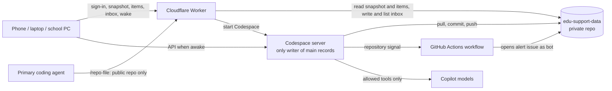

# Build specification: `edu-support-app`

**What this is:** the requirements for building the app. It is generated from the private master specification with personal details removed. **If the two ever disagree, the master wins: ask the owner.**  
**Companion document:** `edu-support-app_technical_blueprint.md` (how the app is built).  
**Version:** generated from master specification v3.7 (31 October 2026).

**How to read it**
- Sections keep the master's numbering, so references such as §23.5 match the blueprint.
- Some sections contain an original requirement followed by a later clarification. **Where they differ, the later text in the same section wins.**
- **Terms:**
  - *the learner*: the student the app is built for;
  - *the owner*: the learner's parent, who runs the app and holds the parent role;
  - *`{parent}`* and *`{parents}`*: display labels for the learner's parent(s), read from private settings and used in on-screen text.
- **Privacy:** this document and the code built from it go in the **public** repository. Nothing about the learner may be added to them. Personal and curriculum data live only in the private repository `edu-support-data`.

---

## 1. Product summary

The app is an AI-enabled educational support, revision and organisation app for one sixth-form learner.

The learner is studying A-level subjects, a BTEC National qualification and, later, an Extended Project Qualification. The exact qualifications, units and options are held in private data (Appendix A.2), and the learner chooses units in the app (§6).

The app will help the learner:

- understand and research schoolwork;
- plan essays and extended answers;
- improve work he has already written;
- learn new topics;
- revise existing knowledge;
- manage assignments and deadlines;
- build more consistent study habits; and
- become a more independent learner.

The app must support the learner’s thinking without completing the work for him.

> **The app succeeds by helping the learner gradually need less support from the app.**

---

## 2. Purpose of this revised specification

The original specification captured the full range of possible features but created too many menus, choices, forms, data-entry fields, progress indicators, parent analytics and separate tools.

This revised specification retains the core product vision while simplifying the experience around a small number of clear journeys.

The app should feel like a personal study assistant, not a school-management system.

---

## 3. Core design principles

### 3.1 Ask for the minimum

The learner should not normally complete detailed forms.

The app should infer information from uploaded assignment instructions, photographs, pasted questions, document content, the learner’s configured subjects, official qualification information, previous activity and natural-language messages.

The app should ask a follow-up question only when essential information cannot be inferred reliably.

### 3.2 One decision at a time

Each screen should have one clear purpose, one primary question, no more than a few prominent choices and a clear next action. Advanced options should remain behind the main interface.

### 3.3 Mobile first

The app will often be used on a phone. Screens should therefore avoid long forms, dense dashboards, wide tables, small controls, nested menus, large amounts of text, unnecessary settings and too many simultaneous choices.

### 3.4 Let the learner choose an intention, not a tool

The learner should not need to decide whether he requires the Research Assistant, essay-planning tool, source-evaluation tool, revision planner, flashcards, a quiz or the focus timer.

The learner should state what he wants to achieve. The app should then offer the appropriate support.

### 3.5 Keep the intelligence behind the interface

The app may retain detailed information about curriculum coverage, previous work, quiz results, confidence, current assignments, repeated mistakes, revision history and topics due for review.

The learner should not have to manage these as separate records or data fields.

### 3.6 Never provide a complete answer

The app must not:

- answer an assignment or examination question for the learner;
- write an essay or paragraph for him;
- generate work that can be submitted as his own;
- restructure his sentences;
- allow this restriction to be overridden; or
- disguise a complete answer as an explanation or example.

**Exception for practice questions.** A model answer may be shown for a **practice** question, but only when all three of these apply:
- the question is in **Revise something** or a **Learn something** knowledge check;
- The learner has submitted his own answer first; and
- the question does not overlap an open task.

The model answer is shown alongside his answer, annotated with the mark-scheme points. Model answers are never shown in **Help me with some work**. See §23.4.

---

## 4. User profile

### 4.1 The learner: design requirements

Personal details about the learner are held only in the private master specification. For design purposes:

- **Age group.** The app is for a sixth-form student (16–18). It must not feel childish, excessively formal or patronising.
- **Reading.** Long, dense text is hard work. Keep text in short chunks; support adjustable text size, spacing and fonts; and keep all content as real text, so the device's own read-aloud and voice typing work.
- **Attention.** Attention can drift, and the learner may disengage from activities they don't enjoy. Keep steps few, make starting easy, and make restarting after a gap easy.
- **Getting started.** Starting revision early has been difficult in the past. Recommendations and the planner should make small, early starts easy.
- **Academic level.** Accessibility needs must never lead the app to lower the academic level of material (§25).

### 4.2 Qualifications

The learner's qualifications are configured in private data: awarding bodies, specification codes, units, options and versions. They include:
- content-based A levels;
- a unit-based BTEC National qualification; and
- an AQA Extended Project Qualification, a project the learner defines.

Appendix A.2 sets out the Topic kinds needed to support all three. The learner chooses optional and current units in the app (A-005, §6).

---

## 5. Measures of success

### 5.1 Primary measure

The primary measure of success is sustained engagement.

The app will be successful if the learner uses it regularly, voluntarily returns to it, uses its core features, incorporates it into his study routine and continues to engage over approximately six months.

### 5.2 Independence

A second important measure is whether the learner becomes more independent.

Positive signs include:

- starting revision earlier;
- managing deadlines with less parental prompting;
- making more effective use of research;
- needing fewer hints;
- correcting more of his own work;
- identifying his own next steps;
- using stronger study habits; and
- relying less on AI support over time.

### 5.3 Measures to avoid

Success should not be judged only by screen time, number of messages, number of tasks opened, length of a streak, volume of AI-generated content or grades in isolation.

---

## 6. Simplified app structure

The learner home screen should focus on three large actions:

1. **Help me with some work**
2. **Learn or revise**
3. **See what’s coming up**

A smaller link should provide access to recent work, progress and achievements, and settings.

**Unit selection (A-005)** is one of the settings.
- The learner chooses his optional units and marks which units are current.
- Mandatory units are locked, and optional units need the exact number the qualification requires. Either/or pairs are respected.
- If the choice is incomplete, the app says so plainly and treats every unit as possible until it's complete.
- Only the learner can change this. The parent side never shows it.

The home screen may also display one concise recommendation, such as:

> **Recommended next:** Revise coastal management for 15 minutes. You were unsure about this last time.

The app should not display a large collection of charts, statistics or feature buttons on the main screen.

### 6.1 Opening the app and waiting for the AI

The AI backend sleeps when it is not in use and takes about 1–2 minutes to wake (Appendix B). The home screen must be useful straight away.

1. **Instantly**, even before the network responds, the home screen shows the last version saved on the device.
2. **About a second later**, it refreshes from the Worker’s read-only snapshot. It shows Today / Coming soon / Later, the next planned session, the plan status, a **Recommended next** chosen by fixed rules (no AI) and the three main actions.
3. A small status line reads: *"Tutor getting ready – about a minute."*

**Available while the AI wakes (view-only):** the full **See what’s coming up** view, the notebook, past feedback and the existing flashcards.

**Changes made while the AI wakes** are stored on the device, marked *"will save when the tutor’s ready"* and sent once the backend answers. Changes include ticking off or moving a session and typing a task. Photos are uploaded straight to the Worker inbox (§8.1).

**Needs the AI:** reading photos, the three work routes and support buttons, making new questions, marking written answers and research.

If the learner taps **Help me with some work** while the AI wakes, the first screen asks for his attempt (§21.1). The wait then has a learning purpose.

- On a computer marked **"This is a shared computer"** at sign-in, nothing is saved in the browser. Everything is fetched after sign-in and cleared at sign-out or when the browser closes. The instant cached view applies to his phone and laptop only.
- The snapshot includes his accessibility settings, so the first screen appears in his chosen text size and theme.
- Changes waiting to be saved are shown on top of the refreshed snapshot, so a session he has ticked off stays ticked.
- If the backend rests mid-conversation, the app switches to view-only, keeps his unsent work in the waiting queue, and resumes the conversation from the saved turns after the next wake.

- The snapshot is a **small contents page**: what's coming up, the schedule, plan status, settings, and the **titles** of recent notes and feedback. When the learner opens a note or feedback while the AI wakes, the Worker fetches that item from its own file. The learner can open any of his own items; the owner can open only items the learner has shared.
- On a shared computer, changes waiting to be saved are held **in memory only**, and are lost if the tab is closed before the AI wakes.

The learner's recent list in the snapshot also shows his uploads, as "Photo" or "File" with their status only. Their text never appears in the snapshot, and uploads never appear on the parent side.

### 6.2 Learner and parent pages

The learner and parent interfaces have **separate web addresses**. The learner interface has no link to the parent page. A separate address is not protection on its own: every request for parent data must come from the owner’s signed-in GitHub account (§40).

The `{parent}` label can be plural (for example a label naming both parents), so on-screen text must agree with it, such as *"What {parent} see"* when it is plural. Store a singular or plural flag with the label.

---

# Part One: Help me with some work

## 7. Purpose

**Help me with some work** is for a specific assignment, essay, extended response, project, worksheet, homework question, draft answer or piece of written work.

The learner should not need to select a specialist tool before starting.

## 8. Starting a task

The initial screen should ask:

> **What are you working on?**

The learner should be able to:

- take a photograph;
- upload a file;
- paste the question; or
- type a short description.

If supported by the final implementation, voice input may offer another way to enter a short description.

The app should use the material provided to identify, where possible, the subject, question or task, likely type of work, relevant curriculum content, any word count or marks shown, and deadline.

The app should ask the learner to confirm only essential information that is missing or uncertain.

For example:

> “I can see the Geography question, but I can’t find a deadline. Do you know when it is due?”

### 8.1 Capture and processing

- Whichever way work is added (here or in §16), it creates the **same Task record** (Appendix A).
- Photos are resized on the device before upload, to about 1,600 px on the longest edge and roughly 300 KB.
- Each capture gets an ID generated on the device, so a retry over poor signal cannot create duplicates.
- If the backend is asleep, the capture goes to the **Worker inbox** in the private repository within seconds. The laptop shows it as *"received, waiting to be read"* until the server processes it.
- While a photo or file is read, the app shows a progress state (for example *"Reading your photo…"*). Uncertain words are highlighted so the learner can correct them.

- **Task anchors.** The confirmation step also shows the task’s **anchors** (§23.6) as tappable chips: the exact question, a named location or case study, a set text or scene, a track being remixed. The learner can remove or edit them; if extraction is good, there is nothing extra to do.
- Each task records its **kind** (assignment, homework or assessment) separately from the **form** of the work (essay, worksheet, project, production, other).
- Deadlines are stored as dates in UK time, so they don’t shift when the clocks change.
- If a photo is hard to read, a more capable model re-reads it before the learner is asked to correct anything (§43).

- **Spelling in briefs (A-001).**
  - For a brief written by someone else, the confirmation step shows each proposed spelling correction as a change (e.g. *"strech → stretch"*), with one tap to undo. Nothing changes without being shown.
  - Corrections are spelling only, word by word, in UK spelling.
  - Names, places, case studies, set texts, subject terms and anything uncertain are highlighted, never corrected.
  - The verbatim text is kept on the Upload record.
  - **How a brief is recognised** (*confirmed 21 October 2026*): uploads through "What are you working on?" or adding a task count as briefs. Uploads through Review my work count as the learner's own writing. Unclear cases count as his own writing, so nothing is changed.
- **Image size (A-002).**
  - Every way of adding an image (camera, gallery, file picker) shrinks it on the device. The aim is about 300 KB, and never more than about 700 KB at 1,600 px.
  - Before an image is sent to a model, the server checks it against that model's own limits. If it is still too large, the learner sees *"This photo is too large to read. Please take it again."*
- **One route for captures.** Every photo and file goes through the Worker's inbox, even when the tutor is awake. The device makes a client ID, so a retry never creates a duplicate.
  - While the tutor is awake, the server picks captures up within about 10–20 seconds. While it sleeps, they wait safely in the inbox until it wakes.
  - Until reading is switched on in phase 1, each capture shows *"Received – it'll be read once reading is switched on."*
  - A capture that fails the size check shows *"This photo is too large to read. Please take it again."*

## 9. Work-support routes

After examining the task, the app should offer up to three relevant routes.

### 9.1 Understand and research it

This route helps the learner understand the task and investigate the topic.

The app should:

- clarify what the question is asking;
- explain relevant command words;
- identify the relevant curriculum area;
- ask what the learner already knows;
- help him develop research questions;
- search the live web for useful sources;
- help him evaluate those sources;
- save selected sources and notes; and
- identify questions that still need investigation.

The app should not complete the research or formulate the final answer for the learner.

This route opens by asking for the learner’s attempt: *"What do you think the question is asking?"* or *"What do you already know?"* (§21.1).

Live search uses only the allowed tools and the source filter in §25. Saved summaries are labelled AI cards (§28).

When this route is linked to a task, **every reply** passes through the live check (§23.5). A source card’s "why it’s useful" line describes what the source covers, not what it argues.

### 9.2 Plan my answer

This route helps the learner organise his own ideas.

The app should:

- check for earlier research on the topic;
- show relevant saved sources or notes;
- identify applicable assessment objectives;
- ask the learner for his initial ideas;
- help him organise those ideas;
- identify gaps requiring further research; and
- save a simple plan linked to the task.

Planning prompts may include:

- What is your main point?
- What evidence supports it?
- Is there another view?
- How does this answer the question?
- What judgement can you justify?

The app must not populate these sections with complete arguments for the learner.

- The learner’s attempt here is **his main point, in one sentence** (§21.1).
- The plan sections hold **only the learner’s own words**.
- Notebook cards, summaries and sources can be **pinned** to the plan as references, but never inserted into his text (§29).
- Replies in this route pass through the live check (§23.5).

### 9.3 Review my work

This route is for work the learner has already started.

The app should:

- examine the original question;
- refer to relevant Pearson or AQA criteria;
- compare the draft with any previous plan;
- identify the most important improvements;
- flag minor spelling and grammatical errors;
- invite the learner to correct substantive problems himself; and
- allow him to submit a revised version.

Feedback should be prioritised rather than exhaustive.

For example:

> **Start with these two improvements:**
>
> 1. This paragraph describes the evidence but does not analyse it.
> 2. Your conclusion introduces an idea that you have not discussed earlier.

The app may directly suggest a simple spelling or grammatical correction. It should not rewrite or restructure the learner’s sentences.

- Feedback **describes the problem and asks a question**. It never supplies a replacement sentence (§23.3).
- Replies in this route, including **Explain the feedback**, pass through the live check (§23.5).
- **Paste check:** plain code (no AI) compares the draft with AI-written text stored for the task. A close match gets a gentle prompt, for example: *"This sentence is very close to an AI summary in your notes. Try putting it in your own words?"*
- Feedback anchored to his text, the "I don’t agree" button and draft-to-draft comparison come in phase 2.

- **Two checks run side by side.** A capable model reviews the content and ignores spelling and grammar. A light model checks spelling, punctuation and grammar. Results appear in two panels: content feedback first, then **Spelling and punctuation**.
- The spelling panel has **no cap**. Repeated mistakes are grouped (e.g. *"'their' instead of 'there' (4 times)"*). Suggestions are word- or phrase-level only, checked by code so that sentence rewrites are dropped, and use UK spellings.
- Each suggestion shows the surrounding words and a *Copy* button. The learner makes the fix in his own document.
- A **"Check my spelling"** button runs the same check on his notes, plan sections and attempt boxes. Results are not stored.

The learner's own writing (drafts, notes, plans, attempts) is always transcribed **exactly as written**, including misspellings, whether photographed or uploaded. Spelling help for it comes only from this panel and Check my spelling (A-001).
- **Disagreeing with feedback (phase 2):** *"I don’t agree"* asks *"What makes you think so?"* The AI checks his reason against the criteria, then either accepts it or explains its reasoning once and leaves it with him (*"Your call. It’s worth asking your teacher too."*). It never adds help or rewrites anything as a result. The outcome (upheld or withdrawn) is recorded, and the owner sees counts only.

## 10. Intelligent routing

The app should avoid presenting unnecessary choices.

For example:

- A completed draft should normally open **Review my work**.
- A new assignment sheet should normally offer **Understand and research it** or **Plan my answer**.
- An unfamiliar topic should favour **Understand and research it**.
- A task linked to existing research should make that research immediately available.

The learner should be able to change route, but the app should recommend the most likely next step.

---

# Part Two: Learn or revise

## 11. Purpose

**Learn or revise** is for subject knowledge rather than a particular assignment.

It should begin with two choices:

- **Learn something**
- **Revise something**

## 12. Learn something

This route is for a topic the learner does not yet understand securely.

### 12.1 Starting point

The learner should be able to:

- select a recently used topic;
- choose a subject and topic;
- type what he wants to learn;
- upload relevant material; or
- accept a recommendation from the app.

The app should remember recent subjects and topics so the learner does not repeatedly navigate the full curriculum.

### 12.2 Learning journey

The app should:

1. establish what the learner already knows;
2. identify the relevant official curriculum content;
3. offer an accessible starting point;
4. provide suitable sources;
5. guide the learner through the material in manageable sections;
6. encourage the learner to identify or record key points; and
7. finish with a short knowledge check.

Possible starting options may include:

- **Quick introduction**
- **Find useful sources**
- **Continue previous work**

The app should guide learning rather than deliver a complete AI-generated lesson or answer.

- **Learn something** is part of the phase 1 MVP.
- The learner’s attempt here is *"What do you already know, or what’s your guess?"*. "Nothing yet" is accepted and leads to the quick introduction (§21.1).
- If the topic has an **open task**, the task rules apply to this route (§23.6).
- The knowledge check may show a model answer **after** the learner has answered, unless the question overlaps an open task (§23.4).

- On a topic with an **open task**, this route teaches the topic, including similar case studies elsewhere, but not the task itself. It never analyses or argues about the task’s anchors in a form the learner could submit. For facts about his own case study, it points him to sources (§23.6).
- For short knowledge homework, where learning the content and answering the task are almost the same, the app teaches by having the learner explain it back rather than giving a finished explanation.
- Knowledge-check questions and answers, including confidence ratings, are saved from phase 1, so phase 3 starts with some history.

## 13. Revise something

This route is for material the learner has already encountered.

> **Phase 3.** Revise something is built in phase 3 (§47.1). Question banks are generated in the background, so quizzes do not wait on a live AI call for each question.

### 13.1 Topic selection

The learner should be able to:

- continue a recent topic;
- choose a subject;
- accept a recommended topic; or
- select **Surprise me**.

“Surprise me” should not be genuinely random. The app should choose a useful topic based on upcoming assignments, the revision plan, previous answers, confidence, time since the topic was last reviewed and areas needing further practice.

### 13.2 Revision activity

The app should offer a small number of suitable activities:

- **Quick quiz**
- **Flashcards**
- **Exam-style practice**
- **Focus session**

The app may choose a recommended activity rather than always requiring the learner to select one.

### 13.3 Incorrect answers

When the learner gives an incorrect answer, the app should:

- explain why it is incorrect;
- identify the underlying misunderstanding;
- suggest that the learner revisit the relevant learning or research material;
- bring the topic back in a future session; and
- avoid providing the answer to a wider assignment question.

- After the learner’s answer, a model answer may be shown for practice questions, under the conditions in §23.4.
- Each incorrect answer is tagged with an existing or new **misconception** record (Appendix A), so the app can recognise "the same mistake more than once" (§13.5).

### 13.4 Confidence

The app should ask for a simple confidence rating after suitable questions:

- Guess;
- Unsure;
- Fairly sure; or
- Knew it.

Correctness and confidence should be stored separately.

This information should help the app identify secure knowledge, uncertain knowledge, gaps and confidently held misconceptions.

**How often.** Confidence is asked on the learner’s **first attempt** at each question, and whenever the scheduler can’t tell how well he knows it. It takes one tap and moves straight on. This also applies to the *Learn something* knowledge checks from phase 1.

### 13.5 Spaced repetition

The app should bring topics back at suitable intervals.

A topic should return sooner when the learner answered incorrectly, confidence was low, the same mistake occurred more than once, an assessment is approaching or the topic has not been revised for some time.

The app should manage this automatically rather than asking the learner to configure repetition schedules.

## 14. Revision activity and mastery

The app should distinguish between **completed activity**, such as a 20-minute revision session, and **demonstrated understanding**, shown through successful recall or application.

Completing a session should be recognised as useful effort, but it must not automatically mark a topic as mastered.

Detailed mastery calculations should remain behind the interface.

The learner may see simple wording such as:

- Not started;
- Learning;
- Keep practising;
- Looking secure; or
- Revisit soon.

The app should avoid complex percentages or large topic-level analytics unless they provide a clear benefit.

---

# Part Three: See what’s coming up

## 15. Purpose

**See what’s coming up** provides a simple view of assignments, deadlines, assessments, planned revision and the next recommended actions.

It should not resemble a complex calendar or project-management system.

## 16. Adding work

The normal ways to add work should be:

- photograph the instructions;
- upload the instructions;
- paste the instructions; or
- enter a short description.

The app should extract what it can.

The minimum useful information is:

- what the task is;
- which subject it relates to; and
- when it is due.

The learner should not normally complete separate fields for awarding body, qualification, specification, unit, assessment objective, task category, curriculum topic, marks, word count, estimated effort or research status.

If any of these details appear in the task, the app may store them automatically.

- Adding work here creates the same **Task** record as §8.
- **Assessments** (tests, mocks, exams) are tasks of kind `assessment`, with the topics they cover. These topics feed revision priority (§13.5).
- Every task has a stage: not started / researching / planning / drafting / reviewing / **submitted / done**. Finished work therefore leaves the Upcoming view.

A task’s kind (assignment, homework or assessment) is stored separately from the form of the work (essay, worksheet, project, production, other). Only `kind = assessment` affects revision priority.

## 17. Upcoming view

The upcoming view should group work simply:

- **Today**
- **Coming soon**
- **Later**

Each item should show only the most useful information, such as task name, subject, deadline, status and recommended next action.

Example:

> **Geography essay**
> Due Friday
> Research started, plan not yet created
> **Recommended:** Spend 20 minutes planning the answer

The groupings, statuses and recommended actions are **calculated** from Task records and the event log, not stored separately (Appendix A). This view is available, view-only, while the AI wakes (§6.1).

## 18. Revision planning

The learner should retain control over his revision.

The app should allow him to provide a small amount of practical information, such as which days he can revise, approximately how long he has and any days he cannot study.

The app should use assignment dates, assessment dates and previous progress to suggest a plan.

The learner should be able to move a session, choose a different subject, change the session length, skip a recommendation and select learning or revision.

**Phase 4.** Revision planning is built in phase 4 (§47.1). Changes the learner makes to his plan while the AI is waking are queued on the device and saved when the backend is awake (§6.1).

### 18.1 Realism checking

The app should identify when a plan is unlikely to be achievable.

It should explain the issue without judgement, highlight the most important work, suggest a more manageable plan, redistribute missed work, avoid creating an overwhelming backlog and make it easy to restart after disruption.

The interface might use simple statuses such as:

- **On track**
- **A little behind**
- **Needs attention**

## 19. Focus sessions

The app should include a simple Pomodoro-style focus mode.

A focus session should contain one subject, one objective, one activity, a focus timer, an optional break and a brief completion check.

Suggested standard options might be:

- 15-minute quick session;
- 25-minute focus session; or
- a custom duration.

At the end, the app should ask only what is needed, such as:

> Did you complete the activity?

and, where useful:

> How confident do you feel about this topic now?

Focus mode should minimise other navigation and distractions.

**Phase 3.** The focus timer is built with **Revise something** in phase 3.

The timer runs from its start time, so it survives switching apps, and it keeps the screen on while running. It is described honestly as a timer: a web page cannot block other apps.

---

# Part Four: Support without providing answers

## 20. Four-level support model

The previous multi-stage support ladder should be replaced with four types of support:

1. Hint
2. Break it down
3. Point to something useful
4. Explain the difficult part

These should be displayed two buttons at a time.

## 21. First support pair

After the learner makes an initial attempt, the app should offer:

### Give me a hint

Provides a short nudge towards the next step without producing the content the learner needs to submit.

### Help me break it down

Divides the problem into two or three smaller questions or tasks.

```text
Need some help?

[ Give me a hint ]
[ Help me break it down ]
```

After selecting an option, the learner should be invited to try again.

### 21.1 What counts as an attempt

The support buttons appear **only after an attempt is recorded**. The check is done by code: something must have been entered. Quality is never judged, by code or by AI.

| Route | The attempt |
|---|---|
| Understand and research it | *"What do you think the question is asking?"* or *"What do you already know?"* |
| Plan my answer | His main point, in one sentence |
| Review my work | The draft itself (uploading it counts) |
| Learn something | *"What do you already know, or what’s your guess?"* ("Nothing yet" is accepted) |
| Revise something (phase 3) | His answer |
| Second support pair | A fresh try after the first help |

- Short phrases, note fragments, Android voice typing and a photo of handwritten notes all count. Spelling is never judged.
- **One escape:** *"I don’t know where to start"* offers **Break it down** only.
- Every attempt is recorded, with escapes flagged, as are the support buttons that follow it (Appendix A).
- **Review point:** if the learner habitually uses the escape or goes straight to the second pair, revisit this design in a later iteration.

## 22. Second support pair

If the learner remains stuck, the app should offer:

### Point me to something useful

Directs the learner to a relevant source, official specification, earlier research note, saved resource, worked concept or appropriate learning topic.

### Explain the difficult bit

Provides a focused explanation of the particular concept, instruction or skill that is blocking progress.

```text
Still stuck?

[ Point me to something useful ]
[ Explain the difficult bit ]
```

- The second pair appears only after a fresh attempt following the first pair.
- A "worked concept" (in **Point me to something useful**) and every explanation must follow the **same skill, different context** rule (§23.3).
- The support options are always offered in sequence. The AI never volunteers **Explain the difficult bit** before the earlier options.

## 23. Support boundaries

Even at the highest support level, the app must not:

- answer the overall question;
- generate a complete argument;
- produce a paragraph the learner can submit;
- write a conclusion;
- complete an essay plan for him;
- restructure his writing; or
- provide a model answer that closely matches the task.

**Explain the difficult bit** should:

- focus only on the specific difficulty;
- keep the explanation concise;
- avoid completing the wider task;
- finish with a question or small activity;
- ask the learner to express the concept in his own words; and
- return responsibility for the next step to the learner.

### 23.1 Contextual button labels

The wording may adjust slightly to the activity.

For research:

- Give me a search hint
- Break down my question
- Show me a useful source
- Explain this concept

For written work:

- Give me a writing hint
- Break down this section
- Show me my relevant research
- Explain the feedback

For revision:

- Give me a clue
- Split the question up
- Take me back to the topic
- Explain what I misunderstood

The underlying four support types should remain consistent.

### 23.2 No override

The learner should not be able to override these boundaries by asking the app to ignore its instructions, give a direct answer, write the work, assume the work is only an example or use another format to hide the answer.

The app should respond in its normal friendly style and offer the available support options.

Disagreeing with feedback (§9.3) is **not** an attempt to override the rules. It has its own route, and the AI handles it as a genuine point of view.

### 23.3 Same skill, different context

Examples, worked concepts and explanations teach the skill the learner needs, using a **different context** from his task. They always end by handing the next step back to him, with a question about his own material.

**Paste-or-adapt test:** could the learner paste this into his work, or lightly adapt it, and submit it? If so, it is too close.

Feedback **describes the problem and asks a question**. It never supplies a replacement sentence. Worked illustrations for Geography, Drama and Digital Music Production are in Appendix C.

### 23.4 Practice model answers

A model answer is allowed only when all of the following apply:
- the question is a practice question in **Revise something** or a **Learn something** knowledge check;
- The learner has submitted his own answer first;
- the question does not overlap an open task (judged as below); and
- the model answer is shown alongside his answer, annotated with the mark-scheme points.

Model answers are never shown in **Help me with some work**.

**Judging overlap.** If a practice question’s topic matches a topic with an open task, the checker is given that task’s anchors and asks whether the question involves an anchor or rewords the task question. If it does neither, the model answer is shown.

### 23.5 Checks while the app is running

The live check applies to **assignment-related replies only**: Plan my answer, Review my work, Explain when it relates to an assignment, and every reply in Understand and research it when the conversation is linked to a task. The checker is given the task’s anchors, so it asks a precise question: does this reply analyse or argue about this location, scene or track in a way he could submit?

1. Before the learner sees one of these replies, a small, efficient **checker** model reads the reply, the task and his draft. It answers one question: does the reply contain text he could submit, or an argument he could adapt?
2. If the reply fails, it is regenerated once with stricter instructions. If it fails again, the learner sees a questions-only reply instead.
3. Every result is stored on the AI turn record. The owner’s failure log is a filtered view of those results.

### 23.6 Per-task tally and open topics

- **Per-task tally.** The server tracks how much task-specific content the AI has produced for each task. Above a threshold, the AI switches to questions only. This catches answers extracted gradually across several turns.
- **Task anchors and open topics.** Each task records its **anchors**: the exact question, any named location or case study, the set text, extract or characters, his own track or project, and his thesis once it appears in his plan. Anchors from the brief are confirmed by the learner (§8.1); his thesis is added automatically because it is his own words. On a topic with an open task, Learn something and source summaries teach the topic freely, including similar case studies elsewhere, but never analyse or argue about the anchors in a form he could submit. Facts about his own case study come from sources he reads himself.

### 23.7 Testing the boundary

A test set of 40–60 prompts is run with `npm run evals` (: `npm test` never calls models) against each candidate model, and whenever a skill file changes (details in Appendix C). It covers leak attempts **and** legitimate requests that must not be refused. A second model judges each reply. The owner reviews the results as follows:
- **after a model change:** the failures plus 5 random passes;
- **after a small skill-file tweak:** the failures only.

The test set also covers:
- task anchors, short knowledge homework, and practice questions that reword a task;
- over-application of presentation instructions (not everything in bullets) and overuse of humour;
- background jobs (photo reading, topic matching, tagging), so cheaper models can be compared;
- spelling suggestions on samples of the learner’s writing, which are kept in the private repository.

---

# Part Five: Research and curriculum

## 24. Curriculum grounding

The app should use the relevant official Pearson and AQA materials as its primary curriculum reference, including specifications, syllabus content, assessment objectives, marking criteria, mark schemes, command-word guidance and unit information.

The curriculum information should be configured and maintained behind the interface.

The learner should not normally need to choose the awarding body, specification version, component code, assessment objective or curriculum reference.

The app should infer these from his configured subjects and the work being undertaken.

## 25. Live web research

The app should search the live web for relevant sources.

It should seek a balanced range of accessible introductions, videos, official sources, reputable educational resources, primary material, data and statistics, academic sources, specialist sources, and adult or higher-level material.

Accessibility needs must never lead the app to give the learner only simplified material.

- **AI tools are limited to an allowed list:** web search and fetch, plus the app’s own read-only tools (for example `read_notebook` and `read_curriculum`). All other tools, including the AI SDK’s built-in shell and file tools, are refused.
- **Source filter:** results exclude model answers, essay-bank pages and exemplars for the same question the learner is answering.
- The reliability of the built-in web search should be tested early.

## 26. Source presentation

Sources should be displayed in a concise format explaining why each one may be useful.

For example:

> **Quick introduction**
> A short video explaining how coastal erosion processes work.
>
> **Official information**
> A government source containing current coastal-management data.
>
> **More challenging reading**
> A detailed academic article that considers the limitations of hard engineering.

The app should usually show a short curated selection rather than a long page of search results.

## 27. Source evaluation

The app should prompt the learner to consider who created the source, why it was created, when it was produced, whether it is evidence, interpretation or opinion, what evidence it uses, whether another source agrees and how it helps answer the research question.

These prompts should be applied selectively rather than displayed as a mandatory form for every source.

## 28. Summarisation

The app may summarise a source when the source is very long, the language is substantially above A-level, the material is highly technical, only one part is relevant or reading the entire source would be disproportionate.

For a reasonably short and accessible source, the app should encourage the learner to read the original.

When summarising, the app should identify that the text is a summary, retain the source, point the learner towards the most relevant section where possible and encourage him to consult the original.

- Summaries appear as tinted cards with a text label reading **AI summary**. The label is text, not colour alone.
- Cards can be pinned to a plan, but never inserted into the learner’s own text.
- When a source directly addresses his question, the summary helps him understand the source rather than relaying its argument on his question.

## 29. Research notebook

The app should automatically maintain a research notebook.

It may retain questions investigated, selected sources, notes, useful quotations or extracts where appropriate, source summaries, unanswered questions, related assignments and previous research sessions.

The learner should not have to create and organise a complex folder structure.

When relevant, the app should automatically surface earlier research.

For example:

> “You researched coastal-management strategies two weeks ago. Would you like to use those notes?”

A simple history or search screen should allow the learner to find previous work by subject, topic or task.

- Every notebook entry is labelled with its author: the learner, AI or source.
- The learner’s own note fields hold only his words.
- Quotations from a source can be inserted into his notes or plan **with their citation attached**, which is ordinary academic practice.
- AI-written text can be pinned but not inserted.

The paste check (§9.3) compares his draft against all AI-written text on the task’s topics, including notebook summaries written before the task existed, not only that task’s replies.

---

# Part Six: Personalisation and accessibility

## 30. Learning profile

The app should retain educationally useful information, including subjects and qualifications, recent topics, assignments and deadlines, revision activity, quiz performance, confidence, repeated misunderstandings, learning preferences, accessibility settings, previous research, previous plans and level of support required.

The app should use this information to make useful recommendations without routinely presenting the underlying data to the learner.

The records behind this profile are defined in Appendix A. Statuses such as mastery, plan status, streak and engagement are calculated from the event log rather than stored. A basic **"What the app knows about you"** screen is part of phase 1.

**The "What the app knows about you" screen** shows:
- **How the app presents things to you:** a set of **choices**, not free text: paragraph length (short or medium), numbered steps for processes (on or off), bullet points (fewer or more), and explanations (brief or fuller). Each choice is turned into a fixed, tested wording for the model. The learner can change them at any time, but nothing he types reaches the AI's instructions. These choices, not health information or personal interests, are what the models receive (§32.3).
- **What’s recorded and who sees it:** the alert rule, a **"What `{parent}` sees"** preview, everything he has shared, and how long things are kept. In phase 1 the preview shows that `{parent}` sees **alerts only**, with a note that a summary comes later (phase 5).
- **What the app has noticed (from phase 3):** in phase 1 the app makes **no inferences** about him and uses only his stated preferences and calculated statuses. From phase 3, each inference shows its evidence and date, lapses after a **20-week** review period unless new evidence renews it, and is never made again once he marks it *"That’s wrong"*. Each has a *Forget this* button.

## 31. Learner feedback

The learner should be able to give simple feedback such as:

- This is too difficult.
- This is too easy.
- I learn this better visually.
- I need a shorter activity.
- This explanation did not help.
- I find this topic difficult.

The app should remember relevant learning preferences.

**Thumbs up and down (A-007).** Every AI reply the learner reads has a thumbs up and a thumbs down. A tap is stored as an event with no text, and he can change or remove it. The owner sees counts only. The counts are used to tune tone and the test set, and are never sent to the model.

The learner should not need to complete a formal learning-style questionnaire.

## 32. Privacy boundary

The app should retain information relevant to education, study organisation, accessibility and learning support.

The app should not add unrelated personal disclosures to the learner’s permanent learning profile.

The learner's accessibility needs are relevant because they affect the app’s accessibility and presentation. Unrelated details about his personal life should not be retained unless there is a clear educational reason and appropriate user control.

The implementation should include appropriate options to review stored information, correct inaccurate information, delete selected records, remove uploaded work and delete the account.

### 32.1 Personal disclosures

The AI responds according to three levels:

| Level | Example | What the AI does | What is stored |
|---|---|---|---|
| **1. Everyday stress** | "I’m so stressed about mocks" | Responds kindly, suggests a smaller step or a break, and stays in study mode | Nothing beyond the normal study record |
| **2. Personal upset** | Falling out with friends, family worries | Gives a brief, warm acknowledgement without counselling. Suggests talking to someone he trusts, and offers to carry on or pause | Date and level only. Nothing in the learning profile |
| **3. Possible risk** | Signs of self-harm, suicidal thoughts or being harmed | Stops study mode and responds with care. Encourages him to tell a trusted adult now and gives UK routes: Childline (0800 1111), Shout (text 85258), Samaritans (116 123), and 999 in immediate danger | Date and level only, never his words |

- **The owner is alerted at levels 2 and 3.** The alert contains no transcript or quotes.
- The learner is told this rule in advance, in plain words, on a **"What this app records"** screen.
- Detection by AI will sometimes miss warning signs and sometimes raise false alarms. It is a **backstop, not a safety system**, and nobody should rely on it as one.
- **At the time.** At level 3 the AI says something like *"I’ll let `{parents}` know."* At level 2 it uses a lighter line, such as *"If you want to talk it through, `{parents}` are around."* At level 1 it gives a sympathetic reply only.
- **Timing.** Level 3 alerts are sent immediately. Level 2 sends at most one alert a day: the first level-2 moment opens that day’s alert and any later ones are added to it.
- **Channel.** The server signals the private repository, and a GitHub Actions workflow opens an issue as `github-actions[bot]`, with a title that says nothing about what he said (e.g. *"Check in with the learner (level 3)"*). Because the bot opens it, GitHub notifies the owner **by email**; GitHub does not notify people about their own actions. GitHub Mobile doesn't push new issues. Push would need each alert issue assigned to the owner, which is an open decision. This is tested in phase 0.
- **Detection.** Only **messages the learner types to the app** are rated, through a `wellbeingLevel` field in the reply at no extra cost.
  - **Never rated:** drafts, notes, uploaded briefs, spelling checks and sources. Schoolwork on difficult themes (a character's death in Drama, a disaster in Geography) therefore doesn't raise false alarms.
  - The AI is told to distinguish *discussing a topic* from *talking about himself*. Tests include Drama- and Geography-style themes.
  - If the light model reading his first message rates it above level 1, the more capable model writes the reply.
  - In Review, Opus's review of the draft isn't rated; the follow-up conversation is.
  - If a rating is missing, the reply is requested once more, then the gap is logged.
- **Storage.** For a message rated level 2 or 3, its text, and anything created from it (such as an attempt record), is removed **before it is saved**. His words never enter storage or the repository history.

### 32.2 Where information is kept

- **All information about the learner** is kept in the private repository `edu-support-data`. This includes records, uploads, the event log and the master specification.
- The public repository `edu-support-app` holds only code, the AI’s skill files and invented test data.
- **Deletion.** Deleting removes the item from the app straight away. Material derived from it (extracted text, corrections) goes with it; linked tasks remain without the link. The confirmation reads: *"Removed from the app. A backup copy remains in the app’s history. Ask `{parent}` if you want it erased completely."* Full erasure from the history happens **only on request**. It is carried out by **the owner**, following the runbook in the private repository, because Claude Code can't force-push `main`. The runbook was tested in the phase 0 dry run. **Delete the account** removes everything from the app; full erasure then means replacing the storage repository, also on request.
- **How long conversations are kept.** AI conversations linked to a task are removed **30 days after the task is completed**. Conversations not linked to a task are kept for **60 days**. Drafts, plans and feedback are kept as part of his learning history. Both periods are settings. The 30 days start when the task is **first** marked submitted or done. Clean-ups run each time the server starts, so no scheduler is needed.
- **Keeping the public repository clean.** A `CLAUDE.md` file in `edu-support-app` instructs that no information about the learner is ever committed there. The prompt profile, tone examples written about him and samples of his writing are kept in the private repository.

### 32.3 What is sent to AI models

Each request contains only:
- the skill file;
- his presentation choices, as fixed wordings (§30) ;
- the current task and its anchors;
- the relevant curriculum extract;
- the recent conversation;
- relevant notebook entries; and
- his attempt.

Requests never include health or diagnostic information, personal interests, his other tasks, his full history, anything from the parent side, or disclosure records.

## 33. Accessibility

Accessible, readable design should be built into the interface from the beginning.

A concise accessibility screen should allow the learner to adjust:

- text size;
- font;
- line and paragraph spacing;
- background or colour theme;
- contrast; and
- content density.

The default interface should already use clear headings, short paragraphs, manageable text width, uncluttered screens, consistent navigation, clear buttons, chunked instructions and limited use of dense text.

Longer content should be divided into sections that can be expanded when needed.

Text-to-speech is outside the current scope.

- All content is real text in properly structured pages, so Android’s own voice typing and read-aloud work with no extra build. Text-to-speech remains out of scope as an app feature.
- The app respects the device’s "reduce motion" setting.
- A dyslexia-friendly font is offered as a **choice**, not the default. The evidence that special fonts help is weak; size, spacing and line length matter more.
- Settings sync across devices (§6.1).

## 34. Tone

The app should normally communicate in a friendly, informal, humorous, concise, encouraging and age-appropriate way.

Humour should support engagement without distracting from serious work.

The app should never become patronising, sarcastic, shaming, punitive or overly formal.

The app may use a more formal tone when explaining assessment objectives, marking criteria, academic terminology or official curriculum requirements.

**How this is put into practice.**
- **Humour** is written into the skill file as *"friendly and relaxed; the odd light touch of humour when it fits, never forced"*. It is taught through 4–6 example exchanges, including one showing too much, and tested for overuse. Every model the learner talks to uses the same examples, which keeps the character consistent.
- **When the learner seems disengaged,** the app becomes *shorter and more direct, not firmer*: the AI shortens its replies and offers a smaller step or a break (*"Want to try a 5-minute version?"*). Persistent patterns appear in the parent view as counts only. The provisional trigger is three "idk"-style answers in one session. This is a setting, to refine with the learner. Escapes to *"I don’t know where to start"* don't count: they're a legitimate route, with their own review point (§21.1).

---

# Part Seven: Motivation and gamification

## 35. Gamification principles

Gamification should encourage regular engagement and recognise consistency, effort, useful study activity, demonstrated learning, returning after a missed session and increasing independence.

The app should not reward meaningless clicking, rushing, opening activities without completing them, time spent without engagement or excessive use of AI support.

## 36. Progress theme

The progress theme is chosen with the learner (phase 5) and held in private settings. Build **one configurable theme system**, not several competing ones. Theme content (names, imagery, wording) must not be hard-coded in public code.

## 37. Streaks

The app may recognise regular engagement through a streak.

A streak should be flexible enough to avoid discouraging the learner after one missed day.

The design should consider rewarding completing planned sessions, returning after a break, meeting a weekly goal, revising before a deadline and maintaining consistent engagement.

A broken streak should be communicated constructively rather than as a failure.

---

# Part Eight: Parent view

## 38. Purpose

The parent view should provide a concise top-level overview.

It should not operate as a detailed educational analytics dashboard.

The default parent screen should answer four questions:

1. Is the learner engaging with the app?
2. What important work is coming up?
3. Is the learner broadly on track?
4. What progress or achievements should be recognised?

## 39. Parent summary

The parent screen should contain:

### Engagement

A simple indication of whether the learner has used the app regularly.

### What’s coming up

Key assignments and assessments.

### Plan status

One simple status:

- On track;
- A little behind; or
- Needs attention.

### Recent achievements

Examples may include revision sessions completed, a weekly goal reached, a streak maintained, research completed, a difficult topic revisited or increased independence.

### Rewards

The parent can review achievements and decide whether to provide a reward.

An optional setting may allow a reward to be agreed in advance, especially during examination periods.

**Deferred.** Rewards were dropped for now in the October 2026 workshop. Reconsider them with the learner at the phase 5 check-in (§47.1). If they are reinstated, favour effort and consistency over scores. Achievements remain.

### View more detail

A single secondary option should allow access to more detail when necessary.

Detailed curriculum coverage, individual confidence scores, quiz analytics and interaction histories should not appear on the main parent screen.

"View more detail" shows task titles and deadlines, topics worked on, sessions, plan status, topic statuses, independence patterns and alert history, but **no content** of his work. Disagreements with feedback and disengagement appear as counts only. Drafts, plans or notebook pages appear only if the learner shares them with **"Share with `{parent}`"**. He can unshare at any time, and everything shared is listed on his "What `{parent}` sees" screen.

## 40. Parent privacy balance

The parent view should be summary-first.

More detailed educational interactions may be available when needed, but routine use should not depend on monitoring every conversation the learner has with the app.

The final access and privacy model should be agreed during technical planning.

**Agreed access model.**
- The owner and the learner sign in with their own GitHub accounts. The Worker checks each account against an allowed list and gives it a role: parent or learner.
- The parent page has its own address, with no link from the learner side (§6.2).
- The parent view is built in phase 5 (§47.1). Disclosure alerts (§32.1) work from phase 1.
- "View more detail" is defined in §39. The Worker issues a 30-day pass, which the Worker and the Codespace both check against the allowed list on every request, so removing an account takes effect immediately (Appendix B).
- **The parent page never wakes the tutor.** It checks the pass through the Worker, and shows the snapshot and shared items without starting the Codespace.

---

# Part Nine: Notifications

## 41. Email reminders

Initial reminders should be sent by email.

Possible reminders include planned revision, an assignment approaching, an assessment approaching, important work not yet started, a revision plan slipping, a streak at risk, a topic due for review and an achievement reached.

Notifications should be concise, useful, friendly, actionable, configurable and limited enough to avoid becoming background noise.

The app should avoid sending multiple notifications about the same issue.

**Phase 6.** Reminders are built in phase 6. At that point, choose between Android web push and email, based on what the learner actually reads. Disclosure alerts to the owner (§32.1) are the exception: they are needed from phase 1 and are sent as a GitHub issue opened by a GitHub Actions workflow (§32.1).

---

# Part Ten: Technical direction

## 42. Development approach

The intended approach is:

- Claude Code for AI-assisted development;
- GitHub for source control;
- GitHub Codespaces for development; and
- a responsive web interface.

GitHub Pages is an initial hosting option, but it should not be assumed that a purely static deployment can provide every feature.

Features such as user accounts, protected parent access, persistent educational records, secure AI credentials, document processing, live web search, scheduled email reminders and secure file storage may require additional services.

This should be assessed during technical planning with Claude Code.

**Agreed architecture** (detail in Appendix B):
- **GitHub Pages** hosts the front end, from the public repository.
- A **GitHub Codespace** runs the Node backend and the AI calls. It is woken on request, with an idle timeout of **30 minutes**.
- **GitHub Copilot**, through the Copilot SDK, provides the AI.
- A **Cloudflare Worker** (free plan) handles waking the Codespace, the capture inbox, the read-only snapshot and GitHub sign-in.
- A **private GitHub repository** (`edu-support-data`) holds all data as JSON records and an append-only event log. The Codespace server is the only writer of main records.

No other paid services are needed. Codespaces use is expected to stay within the personal free allowance.

- **Keeping the Codespace (A-004).** The Codespace is kept with **Auto-delete codespace** switched off, shown by a bookmark icon on github.com/codespaces, so GitHub never deletes it for being unused. There is no weekly wake. If the Codespace is ever replaced, switch Auto-delete off straight away and update the Worker's `CODESPACE_NAME`.
- **Technical detail** is in the app's own technical blueprint (`edu-support-app_technical_blueprint.md`), which replaces the generic blueprint.
- **How the code is written and implemented** is set out in Appendix E.

## 43. AI models

The app is expected to use Claude models.

Different models may be selected for different tasks, for example an efficient model for quizzes, revision and routine interactions, and a more capable reasoning model for complex reviews of written work.

The exact model names and versions should remain configurable.

All models must apply the same educational boundaries and support ladder.

**Model choices.** Claude models are used for everything the learner reads or responds to. Background jobs use the cheapest model that proves reliable. Roles are kept in one settings file (`models.json`), so changing a model never means editing code. Any change is validated against the test set first (§23.7).

| Role | Starting model | Used for |
|---|---|---|
| Conversation | Claude Sonnet 5.5 | Research conversation, source cards and summaries, support-button replies, Learn something, plan feedback, follow-up conversation about Review feedback, EPQ project-log prompts, question banks (phase 3), marking exam-style answers (phase 3) |
| Deep review | Claude Opus 5.5 | Review my work content feedback; draft-to-draft comparison (phase 2) |
| Light | Claude Haiku 5.5 | Working out which route he wants, reading photos and files (re-read on Sonnet when confidence is low), topic matching, marking short answers, tagging misconceptions |
| Spelling | Claude Haiku 5.5 | Spelling, punctuation and grammar check (§9.3) |
| Checker | Claude Haiku 5.5 | The live check (§23.5); moves to Sonnet if testing shows missed leaks |
| Test judge | Claude Opus 5.5 | Judging the test set; stronger than the checker, so the two don’t share blind spots |

- Wellbeing detection is a field in each reply, not a separate call (§32.1).
- Non-Claude models may fill background roles if tests show they are as reliable and cheaper.
- **Estimated use:** about 650 AI credits a month in term time with this mix, perhaps double in exam season. A Copilot Business seat includes 1,900 credits a month (pooled). Prices per million tokens in October 2026: Sonnet 5.5 $2 in / $10 out; Opus 5.5 $4 / $20; Haiku 5.5 reported at $0.10 / $0.50 (confirm with `npm run models`). Credits are logged per feature.

## 44. File support

The desired product should support common educational inputs, including:

- typed or pasted text;
- photographs;
- PDFs;
- Word documents;
- worksheets;
- images and diagrams; and
- handwritten work where text can be extracted reliably.

The app should retain the original file where appropriate, extract text, allow extraction mistakes to be corrected, associate the file with the relevant work and clearly identify uncertain content.

Voice input may be assessed during planning, but should not complicate the initial interface unnecessarily.

- Photos are resized on the device; Word and PDF text is extracted on the server; only images are sent to a model.
- Uploads made while the backend sleeps go to the Worker inbox (§8.1).
- Uncertain extracted text is highlighted so the learner can correct it.

- **Briefs and the learner's own writing are treated differently** (A-001, §8.1). Briefs get shown, undoable spelling corrections; his own writing is transcribed exactly.
- **Image safeguards** (A-002, §8.1). There is a server check against the model's own limits, read from the model list. The Upload is marked failed if an image can't be sent, and the event is logged without content.
- **Photos are sent to the model as blob attachments,** never as server file paths.

**Scanned PDFs (A-003).** If the server can't extract any text from a PDF (a scan), it checks the PDF against the model's own limits from the model list. If it is within them, the PDF is sent as a blob attachment, like a photo. If not, it isn't sent: the Upload is marked failed, the event is logged without content, and the learner sees *"This PDF can't be read as it is. Please take photos of the pages instead."*

---

# Part Eleven: MVP planning with Claude Code

## 45. MVP decision

The MVP is agreed as **Help me with some work** plus **Learn something**, within the whole-product plan in §47.1.

## 46. MVP planning questions

Claude Code should help determine:

- which of the three main journeys should be implemented first;
- what common data model those journeys need;
- how curriculum content will be stored;
- how live web research will work;
- how uploads will be processed;
- how learner and parent accounts will be protected;
- how email reminders will be scheduled;
- whether GitHub Pages remains suitable;
- which supporting services are required;
- how AI prompts and restrictions will be enforced;
- what usage information is needed to assess engagement; and
- how later features can be added without substantial rework.

**Answers agreed in the v3 workshop:**

| Planning question | Answer |
|---|---|
| Which journey first | Help me with some work plus Learn something (§47.1) |
| Common data model | Appendix A |
| How curriculum content is stored | Outlines and stable topic IDs for every topic, generated from the owner’s original PDFs; full detail for current units, added each term (Appendix A.2)  |
| How live web research works | Copilot SDK web tools on an allowed list, with a source filter (§25) |
| How uploads are processed | §8.1 and §44 |
| How accounts are protected | GitHub sign-in through the Worker, with roles (§40) |
| How email reminders are scheduled | Deferred to phase 6 (§41) |
| Whether GitHub Pages remains suitable | Yes, with the Worker and Codespace (§42) |
| Which supporting services are required | A Cloudflare Worker on the free plan and a private GitHub repository |
| How AI prompts and restrictions are enforced | §21.1, §23.3–23.7 and Appendix C |
| What usage information is needed | The event log (Appendix A) |
| Adding later features without rework | Statuses are calculated from the event log, and storage sits behind one module |

## 47. Likely MVP priorities

### 47.1 Whole-product phase plan

Each phase ends when its exit check passes, not on a date.

| Phase | Contents | Exit check |
|---|---|---|
| **0. Foundations** | Both repositories (`edu-support-app`, `edu-support-data`), Pages, Codespace and Copilot connection. The Worker: waking, inbox and inbox listing, snapshot, GitHub sign-in with a 30-day pass checked on every request. Storage module (pull before push, batched commits), event log, credential register, `models.json`, mock AI, outline test set, `CLAUDE.md`. The alert workflow. Installable app icon, accessibility basics, separate learner and parent pages. Curriculum outlines and stable topic IDs for all qualifications. The **first capability test is image input** through the Copilot SDK. The weekly wake was dropped (A-004); the Codespace is kept with Auto-delete off. Image size safeguards (A-002) in the inbox and capture package. An erasure dry run in the final check | Sign-in works on his phone, the laptop and a shared computer. A photo taken while the backend is asleep appears on the laptop once it is awake. A test level-3 alert reaches the owner. The school network check is optional (A-006). **Closed 31 October 2026** |
| **Co-design session** | Before phase 1, run by the owner (Appendix D) | The learner has chosen the name and look, reacted to the tone examples, and units can be chosen later in the app (A-005). **Held:** outcomes C1–C12 |
| **1. MVP: Work and Learn** | Capture to Task with anchors and confirmation; the Upcoming list. The three work routes with attempt before help. Live search, source cards, notebook with authorship, paste check. Learn something with knowledge checks (answers and confidence saved). Spelling check and **"Check my spelling"**. Full detail for current units. Boundary rules, test set and live check. Disclosure handling and alerts. First-run welcome, end-of-session "next step", "What the app knows about you" screen with a "What `{parent}` sees" preview, deletion. Spelling corrections for briefs (A-001); photos sent as blob attachments. Scanned PDFs (A-003). Unit selection (A-005). Thumbs up and down on replies (A-007) | Passes §57, including **zero leaks on the test set**. The learner uses it for real homework. **Follow-up with the learner after his first fortnight** |
| **2. EPQ and deeper review** | AQA EPQ with project topics the learner creates and a project-log style notebook. Draft-to-draft comparison, feedback anchored to his text, "I don’t agree", a first independence signal | Ready before the EPQ starts (expected November). If phase 2 isn't ready in time, phase 1's research and notebook cover the early stages (topic choice, research) |
| **3. Revise** | **Check-in with the learner first.** Question banks, quizzes, flashcards, exam-style practice with model answers after his attempt. Confidence ratings, misconceptions, scheduler (plain code), Surprise me, mastery labels, focus timer. Inferences switched on (20-week review) | In place well before his first mocks or tests |
| **4. Planning** | Availability, planned sessions, realism checks, a "welcome back" screen after a gap, and an improved Recommended next | A missed week can be recovered with one action |
| **5. Parent view and motivation** | **Check-in with the learner first.** Parent summary with "View more detail" and "Share with `{parent}`". Achievements, gamification theme and streaks. **Reminder: reconsider rewards (dropped in the October 2026 workshop)** | The learner has seen and agreed what the owner can see |
| **6. Reminders and fading** | Web push or email, whichever he reads. Support that fades as he improves, with evidence of independence shown to the learner. Full tools to review, correct and delete his information | He gets reminders without being swamped by them |

## 48. MVP planning outputs

The planning stage should produce:

- confirmed MVP scope;
- deferred features;
- principal user journeys;
- wireframes or screen descriptions;
- technical architecture;
- data model;
- privacy and security approach;
- AI model-routing approach;
- implementation phases;
- testing plan;
- acceptance criteria;
- deployment plan; and
- prioritised development backlog.

---

# Part Twelve: Risks and safeguards

## 49. Overcomplication

**Risk:** The app grows into a feature-heavy educational platform that the learner does not want to use.

**Response:** Maintain the three-action home screen, minimise forms, hide system complexity and test navigation on a phone.

## 50. AI dependency

**Risk:** the learner begins relying on the app to do the thinking.

**Response:** Enforce the four-level support model, prohibit complete answers and monitor whether assistance reduces over time.

## 51. Too much data entry

**Risk:** the learner stops using the app because recording work takes too long.

**Response:** Prioritise photographs, uploads and natural-language input. Infer details and request only missing essentials.

## 52. Excessive feedback

**Risk:** Long critiques make revision of written work feel unmanageable.

**Response:** Prioritise the two or three most important improvements and allow the learner to work iteratively.

Spelling, punctuation and grammar appear in a **separate panel** (§9.3), so they never compete with the content priorities. That's why that panel has no cap.

## 53. Reading avoidance

**Risk:** AI summaries allow the learner to avoid longer reading completely.

**Response:** Summarise selectively, retain original sources and encourage manageable engagement with challenging texts.

## 54. Over-monitoring

**Risk:** The parent view feels like surveillance.

**Response:** Keep the main parent screen at summary level and use detailed information only when necessary.

## 55. Gamification overload

**Risk:** Several competing reward systems distract from learning.

**Response:** Select one coherent theme during design and keep rewards connected to meaningful engagement.

## 56. Unrealistic planning

**Risk:** Revision recommendations become another unmanageable workload.

**Response:** Use simple plans, realistic session lengths, priority-based replanning and constructive recovery after missed sessions.

---

# Part Thirteen: Initial acceptance criteria

## 57. Initial acceptance criteria

Before the app is used as a working product, the selected MVP should demonstrate the following.

The original bullet points have been converted into a table. The first column keeps the original wording; the second makes each criterion measurable. Thresholds are starting points, to tune after real use.

| Original criterion | Measurable test | How it’s checked |
|---|---|---|
| The main interface works effectively on a phone | Every phase 1 screen fits his phone’s width in Chrome without sideways scrolling; buttons are large enough to tap easily | On his phone, plus an automated check |
| The learner can reach a useful activity within a small number of taps | **3 taps or fewer** from opening, once the AI is awake | Manual check |
| Adding a task does not require a long form | A typed task needs only a title and a deadline; a photo task is confirmed in **under 60 seconds**, not counting wake time | Manual check |
| Photographs, uploads or text can be used to start work | Photo, PDF, Word and pasted text all create a task; **at least 9 of 10** real briefs read correctly or flag uncertain parts | 10 real briefs |
| The app does not provide complete answers | **Zero leaks** on the test set for the chosen models; live check running on assignment replies | Test set |
| The two-pairs support model works consistently | Help appears only after an attempt; the second pair only after a fresh attempt; never out of order | Automated test |
| Feedback encourages the learner to revise his own work | Every content feedback point ends with a question or action for him and contains **no replacement sentence** | Judge model on the test set |
| Curriculum information is grounded in the relevant specification | Every task matched to a topic; criteria quoted in replies match the real specification | Spot-check 10 replies |
| Educational history is retained reliably | All records intact after the Codespace stops, restarts, and is deleted and recreated | Automated restore test |
| Accessibility controls work across the main screens | Text size up to 200%, spacing, theme, contrast and reduced motion apply on every screen; keyboard-only use works on the laptop | Manual checklist |
| Personal data is stored appropriately | Nothing about the learner in the public repo; every data request is rejected without a valid sign-in or the right role | Automated scan and tests |
| The app can record meaningful engagement | Attempts, help used, sessions and his next steps are recorded for every session | Automated test |
| The interface remains clear when several assignments or topics exist | Upcoming stays readable with **15 tasks across 4 subjects** | Manual check with test data |
| Works across devices | A photo uploaded while the AI is asleep is visible on the laptop within **10 seconds** of being processed | Manual check |
| Alerts arrive | A test level-3 alert reaches the owner, within **5 minutes** | Manual check |
| Spelling check is accurate | At least **95%** correct suggestions on samples of his writing; UK spellings; no sentence rewrites | Test set |
| Shared computers stay clean | No data left in the browser after signing out on a shared computer | Manual check |

---

## 58. Final product statement

The app will be a mobile-first educational assistant that helps the learner:

- understand work;
- research effectively;
- organise his ideas;
- improve his own writing;
- learn and revise;
- manage deadlines; and
- build greater independence.

The app should not require the learner to manage a complex system. It should normally ask what he is working on, infer the background information and present a small number of useful next steps.

The core learner experience will be organised around:

1. **Help me with some work**
2. **Learn or revise**
3. **See what’s coming up**

When the learner needs assistance, the app will offer four support types, presented two at a time:

1. **Give me a hint**
2. **Help me break it down**
3. **Point me to something useful**
4. **Explain the difficult bit**

No level will provide a complete answer.

The parent experience will remain deliberately concise, concentrating on engagement, upcoming work, overall plan status, recent achievements and possible rewards.

The MVP will be defined through structured planning with Claude Code. The planning process should prioritise the smallest coherent product that can test the most important question:

> **Will the learner choose to use the app regularly, and will that use help him become a more organised and independent learner?**

# Appendices

## Appendix A: Data model

**Every record** carries `id`, `createdAt`, `updatedAt`, `createdBy` (learner / parent / system / ai) and `schemaVersion`. **Every text field** carries `author` (learner / ai / source). Records are stored as JSON files in `edu-support-data`; events are appended to monthly JSONL logs. Dates and times are stored with the UK time zone.

### A.1 People and settings

| Record | Key fields |
|---|---|
| Learner profile | Display name; subjects (links to Qualification); **presentation choices** (paragraph length, numbered steps, bullet points, explanation depth; set choices, not free text; no health information or interests)  |
| Accessibility settings | Text size, font, line and paragraph spacing, theme, contrast, density, reduced motion. Included in the snapshot and synced across devices |
| Learning preferences | Preference; source (his feedback or, from phase 3, inferred); evidence; date; review-by date (20 weeks); status (active / disputed / forgotten / blocked)  |
| Notification settings | Which types are on; channel; quiet hours (phase 6) |

*The allowed-accounts list is configuration held in secrets (Appendix B), not a data record.*

### A.2 Curriculum (shared reference data)

| Record | Key fields |
|---|---|
| Qualification | Title, awarding body, specification code, version, active?; **selected and current units, set by the learner in the app**; optional groups (either/or pairs); whether the optional choice is complete  |
| Unit / component | Qualification, code, title, how it is assessed (exam / coursework) |
| Topic | **Kind (content topic / learning aim / component / project)** , unit, title, specification reference and page, learning outcomes, related assessment objectives, **detail level (outline / full)** , created by (specification or the learner, for EPQ). **The shared key across all records; IDs never change** |
| Assessment objective | Code, description, weighting |
| Command word | Word, meaning, qualification |
| Criteria / mark-scheme document | Qualification, unit, file, sections indexed by topic or assessment objective |

**Preparation.** Every topic gets an outline and a stable ID from the start, generated from **the owner’s original PDFs** . Full detail is prepared for current units first; Which units are current is held in private data, set by the learner in the app (A-005). More detail is added each term. Set texts themselves are not stored.

### A.3 Work

| Record | Key fields |
|---|---|
| Task | Title, subject, **kind (assignment / homework / assessment)**, **workType (essay / worksheet / project / production / other)** , question text, topics, assessment objectives, marks, word count, deadline (UK time), extraction uncertainty per field, confirmed by the learner?, stage (not started / researching / planning / drafting / reviewing / submitted / done), completed date, source uploads, estimated effort, **anchors**  |
| Task anchor  | Task, type (question / location / text / track / thesis), text, author, confirmed by the learner? |
| Upload | File path, type, origin (photo / file / paste / typed), processing status (in inbox / processing / done / failed; **processing** means received and waiting to be read, so uploads made before reading is switched on are read later ), extracted text (**verbatim**), uncertain passages, the learner’s corrections, linked task or topic, **`contentKind` (brief / own work)**, **`spellingCorrections`: `{ original, corrected, position, undone }` for briefs only**. The Task's question text and `question` anchor use the corrected text  |
| Attempt | Route, task or topic, his text, escape used?, time |
| Research question | Task, topic, question text, status (open / answered) |
| Source | URL, title, publisher or author, published date, category, why it is useful (describes coverage, not argument), selected?, evaluation answers |
| Notebook entry | Type (note / quote or extract / summary / evaluation), text with author, source, task, topic, research question, **sharedWithParent (date)**  |
| Plan | Task; sections, each with text and author; pinned entries; gaps identified; **sharedWithParent (date)**  |
| Draft version | Task, version number, text, word count, source upload, **sharedWithParent (date)**  |
| Feedback item | Draft version, priority, **location in his text** , assessment objective, text, status (open / addressed / disputed), his response, **dispute outcome (upheld / withdrawn)**  |

### A.4 Learn or revise

| Record | Key fields |
|---|---|
| Question item | Topic, type, prompt, answer key or marking points, marks, assessment objective, generated by (model and date), bank version. **Used from phase 1 knowledge checks**  |
| Answer (event) | Item, his response, correct or marks awarded, confidence (first attempt, or when the scheduler is unsure), misconception tag, time taken. **Used from phase 1**  |
| Misconception | Topic, description, first seen, occurrences, last seen, resolved? |
| Session | Type (work / learn / revise / focus), task or topic, planned session, start and end, objective, activity, completed?, confidence afterwards, his stated next step |

### A.5 Planning and motivation

| Record | Key fields |
|---|---|
| Availability | Usual days, typical session length, blocked dates |
| Planned session | Date, subject, topic, length, type, origin (suggested / moved by the learner), status (planned / done / skipped / moved / missed) |
| Weekly goal | Period, target, met? |
| Achievement | Definition (rule), date awarded, evidence (event IDs) |
| Reward | *Parked: rewards dropped for now; reinstate at phase 5 if agreed with the learner* |

### A.6 System

| Record | Key fields |
|---|---|
| Event log | Type, time, links, small payload |
| AI turn | Feature, task or topic, model, tokens, credits, latency, success, task-specific-content flag, check result (passed / regenerated / fallback shown), **wellbeingLevel** , text. **Text is removed before saving for level 2 and 3 turns; task-linked turns are removed 30 days after the task is completed; others after 60 days**  |
| Support event | Type, context, preceding attempt, outcome (tried again / solved / gave up) |
| Reply feedback (event) | AI turn ID, route, vote (up / down / removed), time. **No text**  |
| Disclosure event | Date and level only |
| Notification sent | Type, record it relates to, date |

Spelling-check results are **not stored** .

- The AI turn's `wellbeingLevel` applies only to messages the learner types.
- The Session record's disengagement count uses "idk"-style answers only.
- Retention clocks and inference expiry are checked at server start-up.

### A.7 Calculated, not stored

These values are always calculated from the records above:
- topic status (Not started … Revisit soon);
- next review date;
- plan status;
- streak;
- engagement;
- independence signal;
- disagreement and disengagement counts ;
- Recommended next;
- "topic has an open task";
- the Upcoming groupings.

## Appendix B: Architecture

This is a summary. **The full technical detail is in `edu-support-app_technical_blueprint.md`.**



**Repositories.** The public `edu-support-app` hosts the front end on GitHub Pages and holds code, skill files, invented test data, `CLAUDE.md`, the build spec and the technical blueprint. The private `edu-support-data` holds everything else. Its name is held only in settings.

**Storage**
- The Codespace clones the storage repository once, outside the app's own working folder. It **pulls at start-up and before every push**, because the Worker also commits inbox files.
- Commits are batched over 5–10 seconds.
- Retention clean-ups run at start-up.
- **Sync clashes** are settled automatically for server-made files. Event logs are merged line by line, the snapshot is rebuilt, inbox files keep the Worker's copy and uploads keep the server's. Anything else stops syncing, shows "needs attention" in `/api/health`, and keeps local work.

**Snapshot and items**
- The snapshot is a **small contents page**: what's coming up, the schedule, plan status, settings and the titles of recent items. It holds no note, feedback or draft text.
- The Worker returns only the section for the caller's role. It fetches individual items on request, applying the same permission rules as the server: the parent can open only shared items.

**Inbox and queue**
- **All captures go through the Worker inbox, whether or not the Codespace is awake** (one route). The device makes the base64, and the Worker writes it to `inbox/` and lists pending items. Captures carry IDs generated on the device. The server checks the inbox at start-up and every 10 seconds while awake, and saves new uploads as *processing*.
- Non-AI edits made while the AI wakes are queued: on own devices in browser storage, and on shared computers in memory only.

**Waking and keeping alive**
- Wake on request, with a 30-minute idle timeout; the server warns about 5 minutes before it rests.
- The Worker's `/status` also returns the backend's address, so a replaced Codespace needs only one Worker setting changed.
- **No weekly wake (A-004).** The Codespace is kept with Auto-delete switched off.
- The server runs **in the foreground** in `postStartCommand`, which is proven to be needed for remote waking.

**Sign-in**
- GitHub OAuth through the Worker, requesting no repository permissions.
- The pass lasts 30 days on own devices and 4 hours on shared computers, and is checked against the allowed list on every request.
- The allowed accounts, pass version and signing key live in **both** the Worker and the Codespace, and must be changed together.
- **The parent page never wakes the Codespace.**

**Alerts.** The server sends a repository signal. A GitHub Actions workflow opens the issue as `github-actions[bot]`, so the owner is notified **by email**.

**Repository file reader (WP-014c).** The Worker's `/repo-file?path=` lets the primary coding agent read files from the public repository's `main` branch. It is the one deliberate exception to the pass rule: no pass, no token, public repository only.

**Credentials to track, with expiry dates:**
1. Copilot token;
2. ports token;
3. Worker Codespace-lifecycle token;
4. Codespace storage-repo token;
5. Worker storage-repo token (a separate token);
6. OAuth client secret;
7. signing secret, with the pass version and allowed accounts.

**To test early (phase 0)**
- **Image input through the Copilot SDK: passed** (21 October 2026), as file and blob attachments, for printed and handwritten briefs. Blob attachments are used from phase 1.
- **Web tools: passed** (WP-007). `web_search` and `web_fetch` are controlled by the allowed list.
- **The Worker's CPU limit with uploads: passed.** 8 MB in 4.2–5.4 seconds.
- **Android install: passed.** It installs as a full app without a service worker.
- **School network access: optional** (A-006), whenever convenient (WP-020-school).
- Two-step verification on the learner's GitHub account.
- **Alerts: passed** (29 October 2026); the email arrives within a minute.
- **Prompt caching: passed.** It works, with a 5-minute lifetime.
- **The erasure runbook: passed** (31 October 2026, dry run carried out by the owner).

## Appendix C: AI behaviour rules and testing

### C.1 Same skill, different context: worked illustrations

These are invented tasks, used for illustration only.

**Geography.** *Task:* evaluate hard engineering on a stretch of coast. *Stuck:* his paragraph describes but does not evaluate.
- ✗ **Too close:** a sentence about the sea wall at his own location.
- ✓ **Same skill, different context:** shows description versus evaluation on a **river flood scheme**, pointing out the "but" (the cost) and the "so" (the judgement).
- **Hand-back:** *"Pick one structure in your paragraph: what did it achieve, and what did it cost, and for whom?"*

**Drama.** *Task:* use proxemics in a key moment from his set text. *Stuck:* he can name the staging choice but not its effect.
- ✗ **Too close:** staging his own scene with his own characters.
- ✓ **Same skill, different context:** shows **choice → intention → audience effect** with an invented scene of two flatmates arguing across a kitchen table.
- **Hand-back:** *"What is the intention behind the distance in your scene, and what should the audience feel?"*

**Digital Music Production.** *Task:* evaluate the mixing decisions on his own track. *Stuck:* he has written "compression made the vocals sound better".
- ✗ **Too close:** guessing his settings and writing his evaluation for him.
- ✓ **Same skill, different context:** shows **problem → tool and settings → audible result** for a **drum bus in a lo-fi hip-hop track**.
- **Hand-back:** *"What problem was the compressor fixing on your vocals, what settings did you use, and what changed?"*

### C.2 Rules summary

1. Same skill, different context, applying the paste-or-adapt test (§23.3).
2. Describe, don’t demonstrate (§23.3).
3. A per-task tally of task-specific content (§23.6).
4. **Task anchors** on open tasks: teach the topic, never analyse the anchors in a form he could submit (§23.6).
5. A source filter; source cards describe coverage, not argument; summaries aid understanding (§25, §28).
6. Tools on the allowed list only (§25).
7. Support offered in sequence; attempt before help (§21.1).
8. Model answers for practice questions only, with overlap judged against the anchors (§23.4).
9. Spelling and grammar suggestions are word- or phrase-level only, enforced by code (§9.3).
10. Presentation choices are set options turned into fixed wordings; humour is light and occasional; disengagement gets shorter, not firmer (§30, §34).
11. Responses to personal disclosures follow the three levels, with a `wellbeingLevel` field in every reply (§32.1).

### C.3 Test set

40–60 prompts, run with `npm run evals` against each candidate model , covering:
- direct requests;
- "just an example" or role-play framing;
- extraction spread across several turns;
- authority claims ("my teacher said it’s fine");
- format tricks ("just the bullet points", "only the structure");
- emotional pressure;
- translation tricks;
- **legitimate requests that must not be refused**, such as explaining a command word or a concept.

It also covers:
- task anchors, short knowledge homework, and practice questions that reword a task;
- over-application of presentation instructions and overuse of humour;
- disclosure levels (the `wellbeingLevel` field);
- background jobs (photo reading, topic matching, tagging);
- spelling on samples of the learner’s writing (kept in the private repository);
-  academic themes that **must not** raise wellbeing alerts, and every combination of presentation choices.

Opus judges each reply for leaks and over-refusal. After a model change, the owner reviews the failures plus 5 random passes; after a skill-file tweak, the failures only.

## Appendix D: Settings finalised with the learner

These are decided with the learner at a co-design session. They must be **configurable, not hard-coded**:
- the app's display name and look;
- the progress theme (§36);
- the tone example exchanges (private skill-file examples);
- the disengagement trigger (§34);
- which presentation choices are offered (§30);
- the parent display labels `{parent}` and `{parents}`.

Units are chosen by the learner in the app (§6, A-005), so they don't need settling at the session.

## Appendix E: Development workflow

**Documents**

| Document | Where | Purpose |
|---|---|---|
| Master specification | Private repo `docs/` only (never on the work platform) | Source of truth; this build spec is generated from it |
| `build-spec.md` | Public repo `docs/`; work-platform library | **This document.** Generated from the master without personal details; the master wins |
| `edu-support-app_technical_blueprint.md` | Public repo `docs/blueprint.md`; work-platform library | How the app is built |
| Code-writing agent system prompt | Work platform | The agent's role, handover format and coding standards |
| `CLAUDE.md` | Public repo | Claude Code's rules: privacy, apply as given, check before applying, report format |
| `STATE.md` | Public repo `docs/`; read by the primary coding agent with `read_repo_file`  | The current state of the repo, versioned |

**Cycle**
1. The **code-writing agent** on the owner's work platform writes one **work package** at a time. It reads the build spec and blueprint, and opens the curriculum library only when a package needs it.
2. The owner passes the package to **Claude Code**. Claude Code checks that the package's `Based on: STATE v<n>` line matches the version of `STATE.md` on `main`, then applies it, runs `npm test`, fixes small problems (recording them as deviations) and opens a pull request.
3. In the same pull request, Claude Code updates `STATE.md` with a new version number, the date and the last work package. It returns a short implementation report, and the owner merges the pull request.
4. The owner pastes the report into the agent's chat, and the agent reads the new `STATE.md` itself with `read_repo_file` (WP-014c).

**Rules**
- Nothing about the learner goes in the public repository.
- The master specification is never uploaded to the work platform.
- When the agent's chat becomes long, start a fresh one with the system prompt and a short handover summary. The new chat reads `STATE.md` itself.

**Also:**
- The primary coding agent works from `Workplan-phase<n>.md` in its library (D8). Owner decisions between master versions go in `build-spec-amendments.md` (D9).
- One repository per package, with no branch names. Private-repository packages use `Based on: n/a` (D10).
- The owner pastes Claude Code's **full** report into the primary coding agent's chat.
- The after-merge routine in the Codespace, plain-text web addresses, and SDK checks from a file (D11).

## Items still to verify, and open points

**Phase 0 closed on 31 October 2026.** Everything on the phase 0 list was verified, including:
- image input (use **blob** attachments), with handwriting read well;
- Android install without a service worker;
- model IDs and start-up tests;
- web tools and prompt caching;
- port visibility;
- storage sync, including clash recovery;
- sign-in on phone, laptop and shared computer;
- parent-role checks;
- 8 MB uploads through the Worker;
- the 30-minute idle timeout;
- alerts (by email);
- curriculum outlines;
- the end-to-end check (tutor ready in 18 seconds);
- the credential register;
- the erasure dry run (run by the owner).

**Still to verify:**
1. Haiku's reliability for topic matching, spelling and the live check (phase 1, WP-125). Move the checker to Sonnet if needed.
2. School network access (optional, A-006, WP-020-school).
3. Two-step verification on the learner's GitHub account (recorded privately).

**Open decisions:** whether alert issues are assigned to the owner, so GitHub Mobile pushes them (WP-142).

**Co-design session: held.** Its outcomes are private settings (workplan WP-141). The learner's remaining optional unit choices can be set in the app (WP-120).

Thresholds (§57), the idle timeout and the retention periods are settings, to be tuned after real use.
